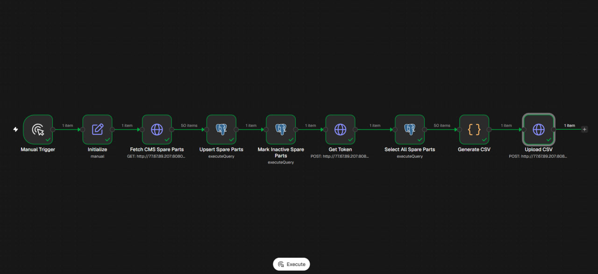
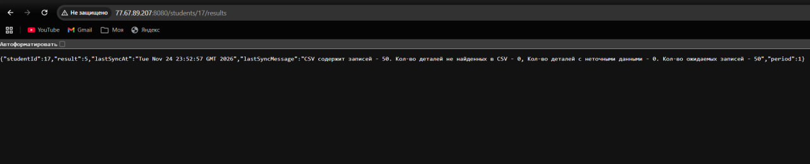

# Интеграция CMS с PostgreSQL

Интеграция CMS с использованием n8n и PostgreSQL.

### Workflow

### Функциональность
- Получение запчастей из CMS.
- Сохранение и обновление данных в PostgreSQL.
- Сохранение истории удалённых запчастей.
- Формирование CSV только с активными запчастями.
- Отправка CSV в Report API.

### Результат

### Запуск проекта
1. Установить Docker и Docker Compose.
2. Выполнить `docker compose up -d`.
3. Импортировать `workflow.json` в n8n.
4. Настроить подключения.
5. Запустить workflow.